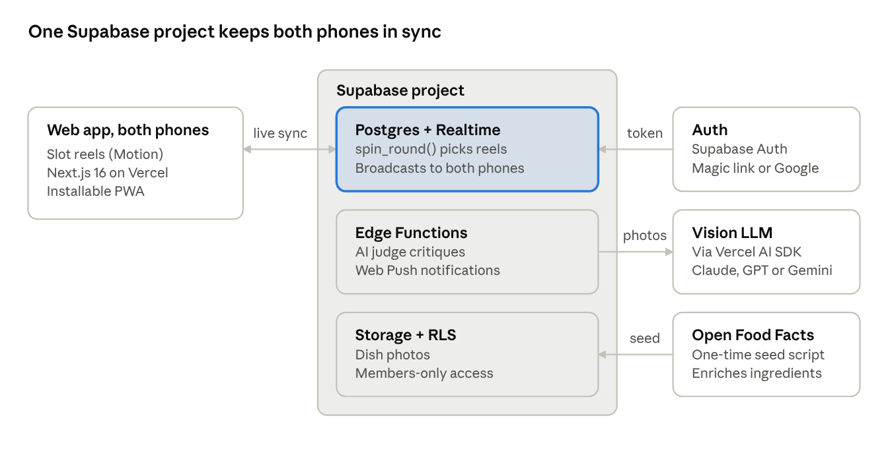
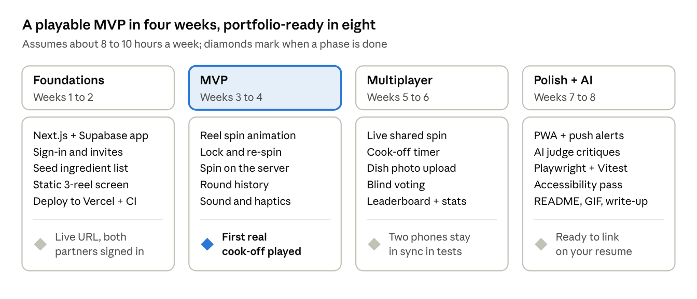

# Grocery Slots — Implementation Plan

Oct 25, 2026 · Josh G · [live doc](https://claude.ai/artifact/Bzu1AGZeta8p1WWxo5Pwy8)

## Concept

Grocery Slots is a web app (installable on phones) where you pull a slot-machine lever, three reels land on random grocery ingredients, and both cooks must use all three in tonight's dish. After cooking, each person uploads a photo, you score each other, and the app keeps a running head-to-head record.

**Core loop:** spin → lock or re-spin reels → start the cook-off timer → upload dish photos → blind vote → winner added to the leaderboard.

**Why it works on a resume:** it is small enough to finish, but it touches the things interviewers ask about — animation and UI polish, real-time sync between two devices, auth, file uploads, a data model with history, an AI feature, testing, and deployment. It also has a story you can tell in one sentence, which matters more than people think.

## Feature scope

Ship the MVP first and put it in front of your partner; everything after that is a resume upgrade, not a blocker.

| Tier | Feature | What it shows on a resume |
| --- | --- | --- |
| MVP | Animated 3-reel slot machine with lever pull, sound and haptics | UI polish, animation |
| MVP | Curated ingredient pool with categories (produce, protein, pantry, wildcard) | Data modeling |
| MVP | Lock a reel and re-spin the others (limited re-spins per round) | Game state management |
| MVP | Sign in, create a "kitchen" (you + partner), share an invite link | Auth, multi-user |
| MVP | Round history: date, ingredients, winner | Persistence, CRUD |
| v2 | Live shared spin: both phones see the reels land at the same moment | Real-time sync |
| v2 | Cook-off timer, photo upload per dish, blind scoring (taste, creativity, ingredient use) | File storage, workflows |
| v2 | Leaderboard and stats (win streaks, most-feared ingredient) | Aggregation queries, charts |
| v2 | Installable PWA with push notification when the round ends | Mobile web, notifications |
| Stretch | AI "judge's notes": an LLM reviews both dish photos and writes a playful critique | Multimodal AI integration |
| Stretch | Difficulty modes (chaos mode pulls from obscure aisles) and budget cap using price data | Product thinking |
| Stretch | Rule modifiers on a 4th reel ("no stove", "20 minutes", "breakfast only") | Extensible game design |
| Stretch | Native app via Expo sharing the same backend | Cross-platform |

Keep the slot theme as a joke, not a mechanic: no money, no streak pressure, no gambling language beyond the visuals. That keeps it fun and avoids an awkward question in an interview.

## Tech stack options

Recommended: **Next.js 16 + React 19 + TypeScript, Tailwind v4, Motion for the reels, Supabase for the realtime backend, and the Vercel AI SDK for the AI judge**, deployed on Vercel. Every piece is current, free at your scale, and widely recognized by hiring managers.

| Layer | Recommended | Alternatives | Why the pick |
| --- | --- | --- | --- |
| Framework | [Next.js 16](https://en.wikipedia.org/wiki/Next.js) (16.4, Oct 2026), App Router, Server Components, Server Actions | TanStack Start (rising, type-safe routing); React Router v7 + Vite | Most-asked-for React framework in job posts; Server Components are the current React pattern |
| Language and tooling | TypeScript (strict), pnpm or Bun, Biome for lint/format | ESLint + Prettier | Biome and Bun signal you follow tooling trends; strict TS is table stakes |
| Styling and UI | [Tailwind CSS v4](https://releases.sh/tailwind-css/tailwind-css/highlights) (CSS-first config) + shadcn/ui components | Panda CSS; plain CSS modules | v4's new engine and theme-in-CSS are the current standard |
| Slot animation | [Motion](https://www.motion.dev) (springs, gestures, layout animations) + View Transitions API between screens | GSAP; a Three.js / React Three Fiber 3D cabinet as a stretch | Spring physics make the reel stop and "bounce" feel real; a 3D cabinet is a strong portfolio flex |
| Database and backend | Supabase: Postgres with SQL migrations, Row Level Security, Storage for dish photos, Edge Functions; typed client generated by the Supabase CLI ([comparison](https://apiscout.dev/guides/convex-vs-supabase-2026)) | Convex (reactive TypeScript backend); Neon Postgres + Drizzle ORM | Shows real SQL, relational modeling and security policies, which transfer to almost any backend job |
| Realtime | Supabase Realtime: a Broadcast channel per kitchen for the live spin, plus Postgres Changes on the rounds table | Ably or Pusher | Built into the same project, so no extra service to run |
| Auth | Supabase Auth (magic link, Google sign-in) | Clerk; Better Auth (open source, popular in 2026) | One less vendor, and auth ties directly into RLS policies |
| AI feature | Vercel AI SDK with a vision-capable model (Claude, GPT, or Gemini), called from a Supabase Edge Function | Direct provider SDK; a Next.js Server Action | Provider-agnostic, streaming UI, structured output with Zod schemas |
| Mobile | Installable PWA first (manifest, service worker, Web Push) | [Expo](https://expo.dev/sdk) + React Native sharing the same Supabase project | PWA reuses the same code; Expo is the stretch "cross-platform" bullet |
| Testing | Vitest (unit), Playwright (end-to-end, two-browser realtime test), pgTAP or SQL tests for RLS policies | Jest; Cypress | Testing the security policies is a detail most portfolio projects skip |
| Hosting and ops | Vercel (preview deploy per PR), Supabase branching or a separate dev project, GitHub Actions CI, Sentry, PostHog | Cloudflare Workers + Pages; Netlify | Preview URLs and real analytics make the project look production-run |

**If realtime becomes the pain point**, Convex is the swap: its queries push updates to every client automatically, at the cost of leaving SQL behind.

## Architecture & data model

The browser only animates; the server decides. When either of you pulls the lever, the app calls a `spin_round()` Postgres function (via RPC) that picks three weighted-random ingredients and writes the round; Supabase Realtime broadcasts the result on the kitchen's channel, and both phones animate to the same stop.

Photos go to Supabase Storage and AI critiques run in an Edge Function, so API keys never reach the browser. Row Level Security policies limit every table to members of the kitchen.

| Table | Key fields | Notes |
| --- | --- | --- |
| users | name, avatar, authId | From the auth provider |
| kitchens | name, memberIds, inviteCode | You + partner; room for friends later |
| ingredients | name, category, aisle, difficulty (1–5), emoji, imageUrl, priceBand | Seeded once, enriched from Open Food Facts |
| rounds | kitchenId, ingredientIds (3), lockedReels, respinsLeft, status, timerMinutes, startedAt | Status: spinning → cooking → judging → done |
| dishes | roundId, cookId, title, photoPath | One per cook per round |
| votes | roundId, voterId, dishId, taste, creativity, ingredientUse (1–10 each) | Hidden until both have voted |
| critiques | dishId, text, model, createdAt | Stretch: AI judge's notes |

## Ingredient data source

Start with a hand-curated list of about 300 ingredients seeded into the database, then enrich it from Open Food Facts. A curated list guarantees every spin is cookable; raw product databases are full of branded snack items that make bad reels.

1. **Seed list (MVP):** a JSON file of generic ingredients, each with a category, aisle, emoji or icon, and a difficulty rating (1 = chicken thighs, 5 = durian). Weighted random picks keep chaos manageable, for example one protein, one produce, one wildcard.
2. **Enrichment (v2):** pull images and nutrition facts from [Open Food Facts](https://openfoodfacts.github.io/documentation/docs/Product-Opener/api/). It is free and needs no API key, but requires a custom User-Agent, limits reads to about 15 requests per minute, and recommends the bulk data export for anything beyond a few hundred items. Its data is under the Open Database License, so credit it in the footer.
3. **Do the enrichment offline:** run a one-time script that fetches, caches and stores results in your own database, rather than calling the API on every spin.
4. **Prices (stretch):** store-specific grocery price APIs are mostly gated or partner-only, so for a budget mode keep a manually maintained price-band field (cheap / mid / splurge) instead.

The randomizer runs on the server, not the browser, so neither of you can "rig" the reels, and both phones receive the same result.

## Milestone roadmap

The goal is a real cook-off with your partner at the end of week 4; weeks 5 to 8 turn it into a portfolio piece.

If a phase runs long, cut from the stretch list rather than slipping the week-4 cook-off — using it for real is what surfaces the bugs worth fixing.

**Week 1 kickoff:**

- [ ] Create the repo and scaffold Next.js 16 with TypeScript and Tailwind v4
- [ ] Create a Supabase project, write the schema above as SQL migrations, and add RLS policies
- [ ] Write the first 100 ingredients in the seed file, with categories and difficulty
- [ ] Connect the repo to Vercel so every push gets a preview link

## Making it resume-worthy

What separates a portfolio project from a toy is evidence that it runs like real software. Budget about 20% of your time for these.

- [ ] **Live demo with a guest mode** so a recruiter can spin without signing up
- [ ] **README** with a 15-second GIF of the reels, an architecture diagram, the stack and why you chose it, and how to run it locally
- [ ] **Tests:** Vitest for the randomizer and scoring logic; a Playwright test that opens two browsers and checks both see the same spin
- [ ] **CI:** GitHub Actions running type-check, lint, tests and a Lighthouse budget on every PR, with a Vercel preview link
- [ ] **Accessibility:** respect reduced-motion settings (skip the spin animation), keyboard-operable lever, announce results to screen readers
- [ ] **Observability:** Sentry for errors, PostHog for a real usage chart (spins per week) you can screenshot
- [ ] **Short write-up** (blog post or LinkedIn) on one hard problem, such as syncing the reel stop across two devices

Sample resume bullet: *Built Grocery Slots, a real-time multiplayer cooking-challenge app (Next.js 16, TypeScript, Supabase/Postgres, Motion) with synchronized slot-machine spins across devices, AI-generated dish critiques via the Vercel AI SDK, and end-to-end tests in Playwright; deployed on Vercel with CI and error monitoring.*

## Sources

- [Next.js — Wikipedia](https://en.wikipedia.org/wiki/Next.js)
- [Tailwind CSS release highlights](https://releases.sh/tailwind-css/tailwind-css/highlights)
- [Motion](https://www.motion.dev)
- [Convex vs Supabase 2026 — APIScout](https://apiscout.dev/guides/convex-vs-supabase-2026)
- [Expo SDK](https://expo.dev/sdk)
- [Open Food Facts API documentation](https://openfoodfacts.github.io/documentation/docs/Product-Opener/api/)
